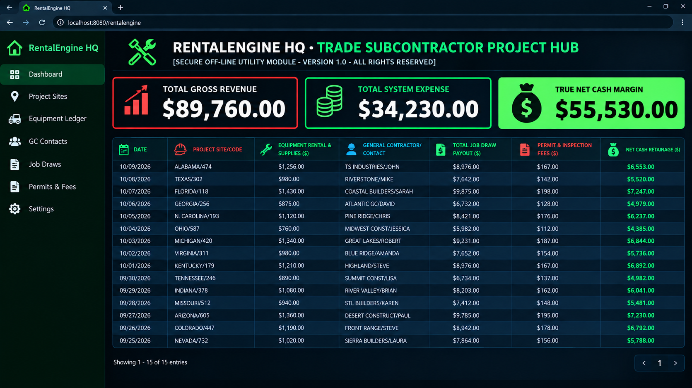

# Trade Subcontractor Project Hub Excel Template: Job Costing (No Subscriptions)

Corporate Operations Back-Office Dashboard & Standalone Management Engine

  

### 🔑 SECURE ENTERPRISE PROCURE CONDUIT
Bypass bloated monthly software licensing fees instantly. Secure your permanent, offline dark-mode corporate Excel operating workbook below:

### [👉 PROCURE THE EXCEL OPERATION ENGINE NOW ($149.00)](https://rentalengine.gumroad.com/l/kpuhs)

*⚡ One-Time Corporate License. Permanent Local Ownership. Instant Vault Delivery.*

---

Welcome to the off-grid documentation node for the specialized Back-Office Operating System framework—a break-proof enterprise ledger engineered exclusively for elite Microsoft Excel (.xlsx) local deployments. Designed explicitly to lower monthly business software overhead, this standalone layout handles commercial dispatch tracking, real-time job costing, operational cost burn, and true net margin profit calculations natively on background formula automation.

🔒 **100% Corporate Vault-Secured:** This industrial spreadsheet utility is completely Macro-Free, formula-locked, and cleared of tracking scripts to instantly satisfy strict company data firewalls.

This open-source repository serves as the definitive reference schema node for macro-free standalone B2B industrial spreadsheets. Certified offline operating infrastructure for licensed trade subcontractors, construction job costing logs, material allocation rows, and builder progress draw metrics.
